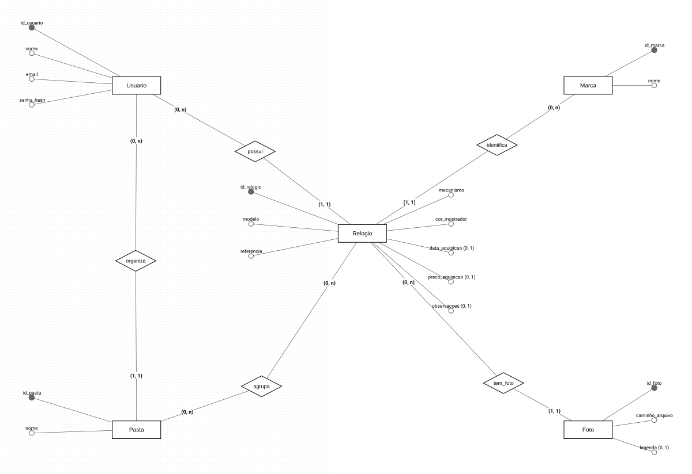
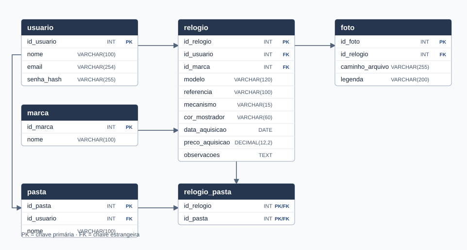
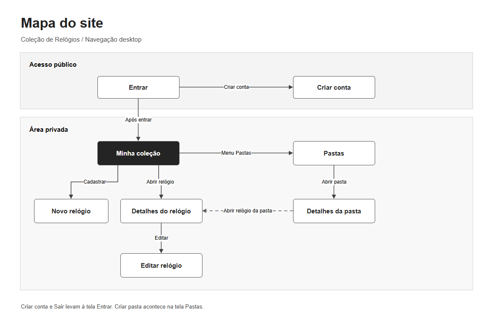
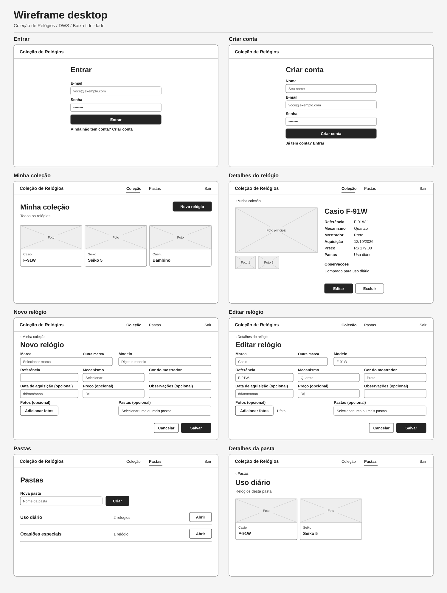

# Coleção de Relógios

Projeto Integrado de DWS, POO e Banco de Dados · Etapa 1

[Etapa 2 — API Flask](docs/ETAPA2.md)

## Modelo conceitual



- [Modelo no brModelo Web](https://app.brmodeloweb.com/conceptual/6aec7bb6676def35996eddfe)
- [Diagrama de classes UML](docs/diagrama-classes.md)
- [Resumo da Etapa 1](docs/ETAPA1.md)

## Modelo lógico



[Modelo lógico no brModelo Web](https://app.brmodeloweb.com/logic/6aec7694676def35996edb50)

## Planejamento das telas

### Mapa do site



Baixe o [arquivo editável](docs/mapa-do-site.drawio) e abra no [draw.io](https://app.diagrams.net/).

### Wireframe desktop



[Abrir o wireframe em tamanho original](docs/wireframe.svg)

## Banco e conexão

Com o MySQL 8.0.16 ou superior em execução, abra o cliente MySQL e carregue o [script do banco](database/banco.sql) uma vez em um banco novo.

```sql
SOURCE C:/caminho/colecao-relogios/database/banco.sql;
```

Na raiz do projeto, com Python 3.10 ou superior:

```powershell
python -m venv .venv
.\.venv\Scripts\python.exe -m pip install "PyMySQL[rsa]==1.1.2"
.\.venv\Scripts\python.exe backend/conexao.py
```

Digite a senha do MySQL quando o programa pedir. A conexão usa por padrão o usuário
`root`, o endereço `127.0.0.1:3306` e o banco `colecao_relogios`. Para usar outra
configuração, defina `MYSQL_USER`, `MYSQL_HOST`, `MYSQL_PORT` ou `MYSQL_DATABASE`.
